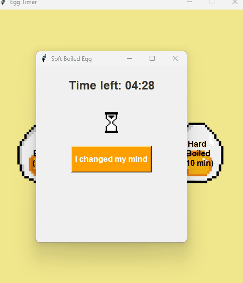
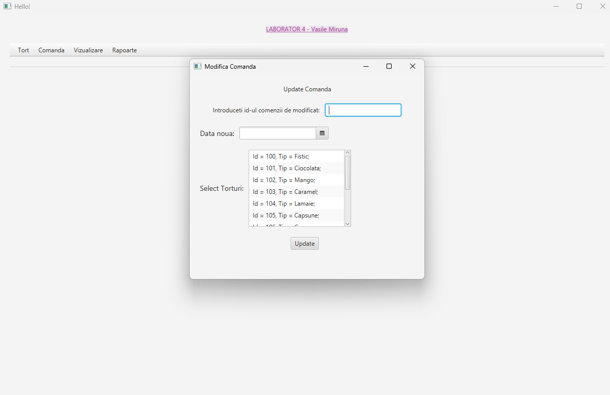
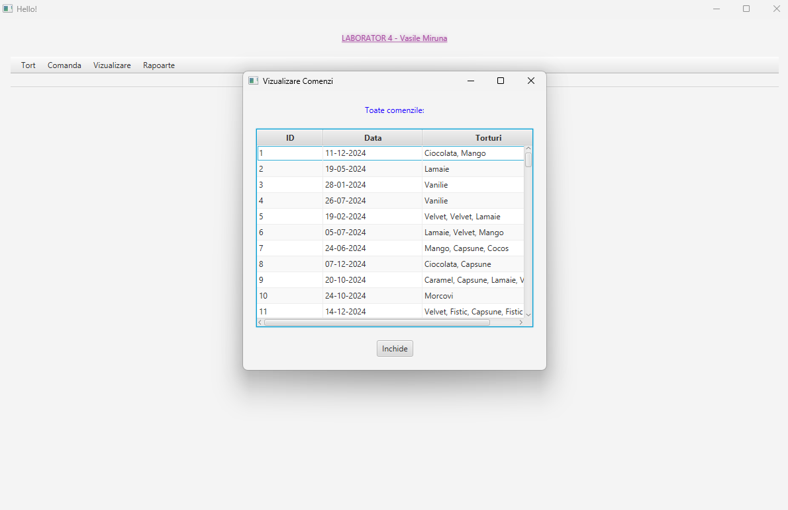

# Small Projects 

This repository contains my first small projects, the beginnings of my journey, made either for university projects or in my free time.

---

## Projects:
- ⏳ *Egg Timer* – An egg timer Python app using Tkinter to help you perfectly boil your eggs. (Pixel art made by me)

---

- 🍰 *Cake-Manager-App* - My first GUI application, built with Java and JavaFX: an order management system for cakes, with menus, forms, a DatePicker, lists and tables.

| Modifică comandă | Vizualizare comenzi |
|:---:|:---:|
|  |  |
---

